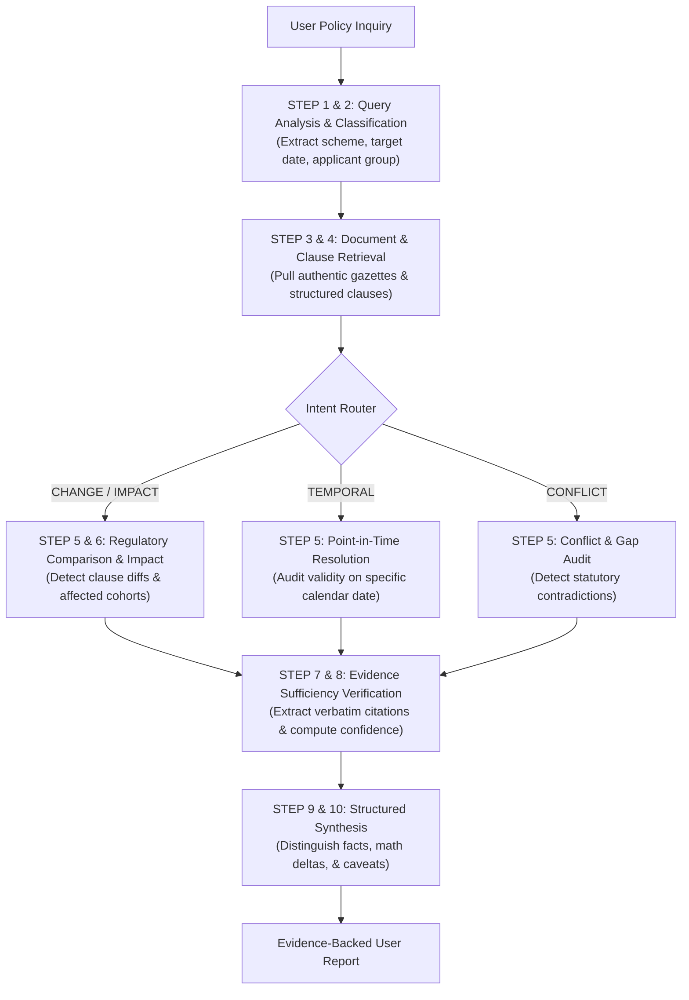

# Policy Intel: AI-Powered Regulatory Change Intelligence Platform

[](https://www.python.org/)
[](https://fastapi.tiangolo.com)
[](https://langchain-ai.github.io/langgraph/)
[](https://reactjs.org/)
[](https://www.postgresql.org/)
[]()

> An authoritative, evidence-backed regulatory change intelligence platform designed for Indian Central Government education policies and scholarship frameworks.

---

## 1. Problem Statement & Platform Objective

Indian Central Government education and scholarship guidelines evolve continuously through a dense sequence of gazette notifications, office memorandums, corrigenda, and multi-year scheme revisions. Standard LLM chatbots and naive Retrieval-Augmented Generation (RAG) pipelines fail because:
- **No Temporal Validity**: They confuse historical regulations with active ones.
- **No Clause-Level Granularity**: They miss minor text edits (e.g. income ceiling ₹2,50,000/- vs ₹3,50,000/-) that carry major legal and financial ramifications.
- **Hallucinations & Ungrounded Claims**: They provide conversational answers without verifiable statutory provenance.

**Policy Intel** solves this by unifying:
1. **Document Acquisition & Clause Extraction (Person 1)**: Deterministic regex parsing of official PDF gazettes into structured, numbered legal clauses.
2. **Regulatory Intelligence & Reasoning Engine (Person 2)**: Bipartite clause matching, temporal validity resolution, conflict detection, and a multi-relational Knowledge Graph.
3. **Platform API, LangGraph Agent & Interactive UI (Our Ownership)**: FastAPI backend, dual PostgreSQL/SQLite persistence, stateful 10-step agentic investigation, and an interactive React + TypeScript platform.

---

## 2. Authentic Policy Corpus

The platform comes pre-seeded with authentic, un-fabricated policy revisions directly from official government ministries:

| Scheme Name | Issuing Ministry | Baseline Revision | Amending Revision | Official Portal |
|---|---|---|---|---|
| **Post-Matric Scholarship for SC Students (PMS-SC)** | Ministry of Social Justice and Empowerment (MoSJE) | 2018 Guidelines (`F.No. 11014/01/2012-SCD-I`) | 2020 Revision (`F.No. 11014/01/2018-SCD-I`) | [socialjustice.gov.in](https://socialjustice.gov.in/schemes/post-matric-scholarship-sc) |
| **National Means-cum-Merit Scholarship Scheme (NMMSS)** | Ministry of Education (MoE) | 2017 Guidelines | 2022 Revision | [scholarships.gov.in](https://scholarships.gov.in) |
| **Central Sector Scheme of Scholarships for College and University Students (PM-USP CSSS)** | Ministry of Education (MoE) | 2015 Guidelines | 2022 Revision | [education.gov.in](https://www.education.gov.in/scholarships-education-loan-0) |

---

## 3. System Architecture & Repository Layout

```
Forge 26/
├── backend/                  # Platform API & Agent Orchestration
│   ├── main.py               # FastAPI entry point, lifespan, & static mounting
│   ├── config.py             # Settings, database URLs, CORS
│   ├── database.py           # SQLAlchemy dual PostgreSQL/SQLite engine
│   ├── models.py             # ORM models (documents, clauses, changes, evidence)
│   ├── agent.py              # LangGraph 10-step regulatory investigation agent
│   ├── api/                  # Modular route handlers
│   │   ├── documents.py      # /api/documents (CRUD & Ingestion)
│   │   ├── policies.py       # /api/policies (Schemes & Timelines)
│   │   ├── changes.py        # /api/changes (Clause-level Diffs)
│   │   ├── impact.py         # /api/impact (Cohort Analysis)
│   │   ├── graph.py          # /api/graph (Knowledge Graph exports)
│   │   └── agent.py          # /api/agent (LangGraph investigation)
│   └── services/             # Business logic layer
│       ├── persistence_service.py
│       ├── intelligence_service.py
│       └── evidence_service.py
│
├── ingestion/                # Document Ingestion & Parsers (Person 1 contract)
│   ├── extractor.py          # Regex structural clause extractor
│   ├── corpus_loader.py      # Authentic government corpus loader
│   └── service.py            # Ingestion orchestration
│
├── intelligence/             # Regulatory Intelligence Engine (Person 2 contract)
│   ├── engine.py             # Unified PolicyIntelEngine facade
│   ├── clause_matcher.py     # Bipartite optimal clause alignment
│   ├── change_detector.py    # Clause-level change detection
│   ├── change_classifier.py  # 8 canonical change classifications
│   ├── knowledge_graph.py    # Multi-relational temporal graph (NetworkX)
│   ├── temporal_resolver.py  # Point-in-time regulatory validity
│   ├── impact_analyzer.py    # Multi-dimensional student cohort impact
│   ├── conflict_detector.py  # Contradiction & ambiguity auditor
│   └── normalizer.py         # Indian currency (₹, Lakh), dates, & units
│
├── frontend/                 # React 19 + TypeScript + Tailwind CSS UI
│   ├── src/
│   │   ├── components/       # Navbar, EvidenceModal
│   │   ├── pages/            # Dashboard, Explorer, Compare, Impact, Graph, AI
│   │   ├── services/         # Typed API client
│   │   └── types/            # TypeScript data contracts
│   └── dist/                 # Production pre-built assets
│
├── shared/                   # Authoritative Shared Contracts
│   ├── schemas.py            # Pydantic models (Document, Clause, ChangeRecord, etc.)
│   └── constants.py          # Ministries, schemes, portals, confidence levels
│
├── migrations/               # Alembic database migrations
├── tests/                    # 60 Unit & Integration Tests (100% passing)
│   ├── intelligence/         # Intelligence engine test suites
│   └── integration/          # API, database, and agent workflow tests
├── docs/                     # Architectural & API Documentation
│   ├── system_architecture.md
│   ├── api_documentation.md
│   └── deployment.md
├── requirements.txt          # Python dependencies
└── .env.example              # Environment variables template
```

---

## 4. Quickstart Guide

### Prerequisites
- Python 3.11+
- Node.js 18+ & npm (for frontend development)

### Step 1: Install Backend Dependencies
```bash
pip install -r requirements.txt
```

### Step 2: Run Backend & Serve Production Frontend
The backend automatically seeds the authentic government corpus and mounts the pre-built React frontend at `/`:
```bash
python -m backend.main
```
Open **[http://localhost:8000](http://localhost:8000)** in your browser!

Interactive Swagger API docs are available at **[http://localhost:8000/api/docs](http://localhost:8000/api/docs)**.

### Step 3 (Optional): Run Frontend in Live Dev Mode
```bash
cd frontend
npm install
npm run dev
```
Access the Vite dev server at **[http://localhost:5173](http://localhost:5173)** (pre-configured with `/api` proxy to `:8000`).

---

## 5. Multi-Step LangGraph Agent Workflow



---

## 6. Running Tests

Run the full test suite (60 tests across unit intelligence and end-to-end integration):
```bash
pytest -v
```

---

## 7. License

Built for Hackathon Forge 26. MIT License.
