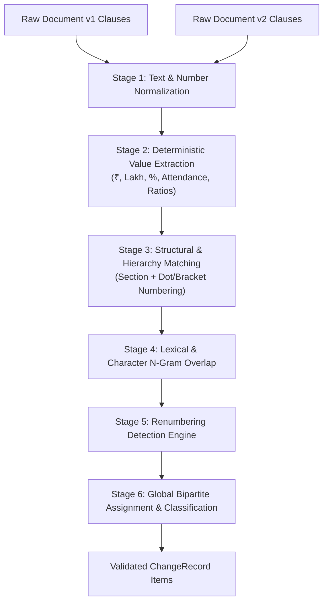

# Policy Intel: Clause-Level Change Detection Methodology

## 1. The Fundamental Problem in Regulatory Change Detection

A major failure mode of standard AI summaries and naive semantic search in legal contexts is **false equivalence caused by embedding proximity**:

Consider the following two clauses from consecutive policy guidelines:
- **Version 1 (2017)**: *"Students whose parental annual income from all sources does not exceed ₹ 1,50,000/- per annum are eligible."*
- **Version 2 (2022)**: *"Students whose parental annual income from all sources does not exceed ₹ 3,50,000/- per annum are eligible."*

If compared using dense sentence embeddings (e.g., standard transformer vector cosine similarity), the similarity score exceeds **0.96**. A generic semantic similarity filter would classify this as *"essentially identical"* or *"minor editorial rewording"*.

In administrative reality, this change **more than doubles the eligibility threshold**, admitting millions of students from economically weaker sections into the scholarship scheme!

Policy Intel rejects purely probabilistic embeddings as proof of regulatory equivalence. Instead, we implement a **hybrid 6-stage clause comparison pipeline** combining structural hierarchy, deterministic text normalization, fuzzy token alignment, numeric scalar extraction, and legal modality shift detection.

---

## 2. The 6-Stage Hybrid Detection Pipeline

### Stage 1: Text & Number Normalization
- Normalizes whitespace, non-breaking spaces (`\xa0`), unicode quotes (`“`, `”`, `‘`, `’`), and dashes (`—`, `–`).
- Normalizes Indian currency strings: `Rs.`, `Rs `, `INR`, `₹` are mapped to a standard `₹ ` token.
- Normalizes periodicity: `p.a.`, `p.m.`, `annually`, `monthly` are standardized to `per annum` and `per month`.
- Normalizes clause numbering: strips prefixes ("Clause", "Para", "Section", "Rule") and normalizes hierarchies (`"4.1."` -> `"4.1"`, `"(4.1)"` -> `"4.1"`).

### Stage 2: Deterministic Parameter Extraction
- Indian currency parser maps words and numerals to standardized floating-point scalars:
  - `"₹ 2.50 Lakh"` $\rightarrow 250000.0$
  - `"₹ 2,50,000/-"` $\rightarrow 250000.0$
  - `"two lakh fifty thousand"` $\rightarrow 250000.0$
  - `"₹ 8.0 Lakhs"` $\rightarrow 800000.0$
  - `"60:40"` $\rightarrow$ Central: $60\%$, State: $40\%$
  - `"55% marks"` $\rightarrow 55.0\%$
  - `"75% attendance"` $\rightarrow 75.0\%$

### Stage 3: Structural & Numbering Alignment
Clause numbers are evaluated for hierarchical relatedness:
- Exact number match: e.g. `"4.1"` vs `"4.1"` $\rightarrow 1.0$
- Common prefix match: e.g. `"4.1"` vs `"4.1.1"` $\rightarrow$ prefix overlap ratio ($0.67$)
- Cross-section penalty: clauses in completely different sections are penalized unless textual similarity is overwhelming.

### Stage 4: Lexical & Character N-Gram Overlap
Computes composite textual similarity using:
1. **Character 3-Gram Cosine Similarity**: Robust against minor typos, spelling variations, and punctuation differences.
2. **Token Multiset Dice Coefficient**: Measures lexical overlap across word bags.
3. **Jaccard Similarity**: Measures vocabulary alignment.

$$\text{Composite Lexical Sim} = 0.40 \cdot S_{\text{ngram}} + 0.40 \cdot S_{\text{overlap}} + 0.20 \cdot S_{\text{jaccard}}$$

### Stage 5: Renumbering Detection
A critical challenge in government policy revisions is clause renumbering. For example:
- A new section is inserted at paragraph 3, shifting Clause 4.2 of v1 to Clause 5.1 of v2.
- A naive positional matcher would misidentify Clause 4.2 as *REMOVED* and Clause 5.1 as *ADDED*.

**Policy Intel's Renumbering Heuristic**:
If numbering similarity is low ($S_{\text{num}} < 0.50$) but textual similarity is very high ($S_{\text{lexical}} \ge 0.78$), the matcher flags the pair as **`RENUMBERED`**:
- The clause pair is linked as a modification rather than a spurious addition/removal.
- A detailed uncertainty is attached: *"Clause renumbered from 4.2 to 5.1; core text retained."*

### Stage 6: Global Bipartite Optimal Assignment
- Constructs a full similarity score matrix between all $M$ previous clauses and $N$ current clauses.
- Executes greedy maximum-weight bipartite assignment with a threshold cutoff ($\theta_{\text{min}} = 0.60$).
- Unpaired current clauses are classified as candidate additions (`ADDED`).
- Unpaired previous clauses are classified as candidate removals (`REMOVED`).

---

## 3. Change Classification Typology

Every verified change is classified into one of 8 canonical ChangeTypes:

| ChangeType | Definition | Statutory Presumption & Legal Caveats |
|---|---|---|
| `ADDED` | Clause exists in new document with no prior counterpart. | Represents a newly introduced administrative or eligibility provision. |
| `REMOVED` | Clause existed in prior document but absent in new document. | **Caveat**: Absence does *not* confirm legal repeal without an express superseding order. An uncertainty warning is explicitly generated. |
| `MODIFIED` | Clause matched across versions, but text or parameters shifted. | Core provision retained with quantitative or procedural alterations. |
| `REPLACED` | Contains express substitution language (*"shall be substituted by..."*, *"in supersession of..."*). | Formal statutory replacement of preceding clause. |
| `EXTENDED` | Validity years, deadlines, or scope extended (*"extended up to 2025-26"*). | Temporal elongation of existing regulatory conditions. |
| `EXEMPTED` | Introduces exceptions, concessions, or waivers (*"relaxable by 5% for SC/ST"*, Freeship Card). | Carves out specialized conditions for targeted beneficiary cohorts. |
| `CLARIFIED` | Procedural or interpretive clarification (*"for the removal of doubts"*) without altering numeric thresholds. | Explanatory note or guidance without criteria alteration. |
| `UNKNOWN` | Ambiguous difference where legislative intent cannot be verified. | Flagged for administrative manual investigation. |

---

## 4. Evidence Engine Provenance

Under Policy Intel's architecture, **no change record can silently appear without verbatim evidence**.
Every `ChangeRecord` contains:
- `document_id`: Source official document identifier
- `clause_id`: Source clause identifier
- `exact_supporting_text`: Exact verbatim quotation from the gazette/guidelines
- `is_inferred`: Boolean flag distinguishing direct provisions from derived deductions
- `confidence`: Confidence score ($0.0$ to $1.0$)
- `uncertainties`: Explicit caveats highlighting legal ambiguities or missing dependencies
