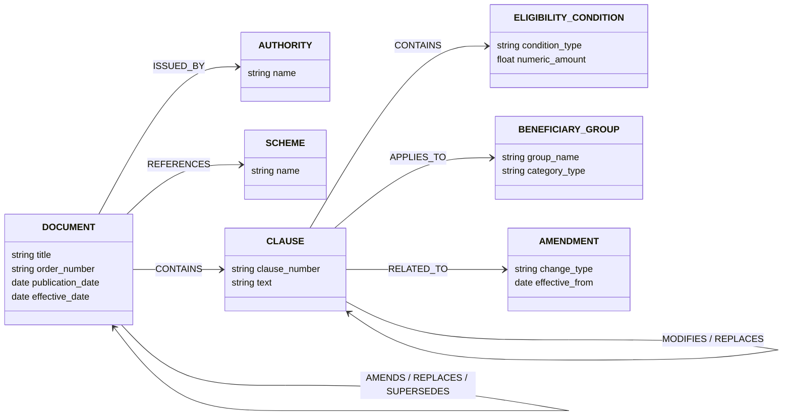
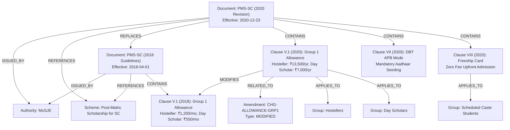

# Policy Intel: Temporal Regulatory Knowledge Graph Schema

## 1. Schema Philosophy and Backend Portability

The Regulatory Knowledge Graph represents statutory and administrative relationships across government policies, notifications, amendments, conditions, and beneficiary cohorts.

To support rapid in-memory processing while providing enterprise portability, the graph is built on an abstract interface:
- **`BaseRegulatoryGraph`**: Abstract Base Class defining standard node insertion, edge creation, multi-relational querying, temporal filtering, and serialization.
- **`NetworkXRegulatoryGraph`**: Concrete implementation utilizing `networkx.MultiDiGraph` with rich dictionary attribute storage for nodes and edges.
- **Neo4j Portability**: Method signatures and property mappings mirror Cypher entity semantics, allowing seamless replacement with a `Neo4jRegulatoryGraph` driver.

---

## 2. Node Schema Definition

| Node Type (`NodeType`) | ID Convention | Typical Properties | Temporal Attributes | Description |
|---|---|---|---|---|
| `SCHEME` | `SCHEME-<NAME>` | `name` (e.g., "Post-Matric Scholarship for SC") | N/A | The governing central government scheme entity. |
| `DOCUMENT` | `DOC-<MINISTRY>-<SCHEME>-<YEAR>` | `title`, `document_type`, `order_number`, `source_url`, `version`, `status` | `publication_date`, `effective_date`, `valid_until` | A formal legal document (guidelines, OM, gazette, circular). |
| `AUTHORITY` | `AUTH-<MINISTRY>` | `name` (e.g., "Ministry of Social Justice and Empowerment") | N/A | The central department or ministry issuing regulatory directives. |
| `CLAUSE` | `<DOC_ID>-CL-<NUM>` | `clause_number`, `title`, `section`, `clause_type`, `text`, `structured_attributes`, `page_number` | Inherited from parent document | An individual regulatory provision or paragraph. |
| `ELIGIBILITY_CONDITION` | `COND-<CLAUSE_ID>` | `condition_type`, `raw_criteria`, `numeric_amount`, `currency`, `unit` | Inherited from clause | Normalized rule extracted from an eligibility clause. |
| `BENEFICIARY_GROUP` | `GRP-<NAME>` | `group_name`, `category_type` | N/A | Target demographic or academic cohort (e.g. "Undergraduate SC Students"). |
| `AMENDMENT` | `CHG-<HASH>` | `change_type`, `previous_value`, `current_value`, `confidence`, `uncertainties` | `effective_from` | A verified change event modifying regulatory state. |
| `DEADLINE` | `DEADLINE-<CLAUSE_ID>` | `deadline_type`, `academic_year`, `target_date` | `valid_from`, `valid_until` | Administrative application or renewal cutoff date. |

---

## 3. Relationship Schema Definition

Every edge in the knowledge graph is multi-relational and carries evidence and temporal applicability metadata:



### Detailed Relationship Types

| Relationship (`RelationshipType`) | Source Node Type | Target Node Type | Required Attributes | Description |
|---|---|---|---|---|
| `ISSUED_BY` | `DOCUMENT` | `AUTHORITY` | `temporal_info` | Declares the issuing regulatory ministry. |
| `CONTAINS` | `DOCUMENT` | `CLAUSE` | `temporal_info` | Structural containment of a clause within a policy document. |
| `CONTAINS` | `CLAUSE` | `ELIGIBILITY_CONDITION` | `temporal_info` | Identifies an eligibility criterion established by a clause. |
| `APPLIES_TO` | `CLAUSE` / `SCHEME` | `BENEFICIARY_GROUP` | `evidence`, `temporal_info` | Associates a provision with its target demographic or academic cohort. |
| `REFERENCES` | `DOCUMENT` | `SCHEME` | `properties.role` | Associates a regulatory text with its scheme. |
| `AMENDS` | `DOCUMENT` / `AMENDMENT` | `DOCUMENT` | `evidence`, `temporal_info` | Formal amendment of an earlier document without complete repeal. |
| `REPLACES` | `DOCUMENT` | `DOCUMENT` | `evidence`, `temporal_info` | Complete administrative replacement of a prior policy version. |
| `SUPERSEDES` | `DOCUMENT` | `DOCUMENT` | `evidence`, `effective_date` | Statutory cancellation of previous rules by newer notification. |
| `MODIFIES` | `CLAUSE` | `CLAUSE` | `evidence`, `change_type` | Clause-level parameter or text alteration. |
| `RELATED_TO` | `CLAUSE` | `AMENDMENT` | `evidence`, `temporal_info` | Links an affected clause to its change record event. |

---

## 4. Real Policy Graph Representation (Mermaid)

The following diagram illustrates the actual relationships modeled between the 2018 PMS-SC guidelines and the 2020 revision:



---

## 5. Cypher / Neo4j Migration Mapping

When switching from `NetworkXRegulatoryGraph` to `Neo4jRegulatoryGraph`:
- Graph nodes map to Neo4j Node Labels (`:Document`, `:Clause`, `:Scheme`, `:BeneficiaryGroup`).
- Graph edges map directly to Neo4j Directed Relationships (`[:AMENDS]`, `[:CONTAINS]`, `[:APPLIES_TO]`).
- Evidence arrays are stored as JSON strings or related `:EvidenceRecord` nodes linked via `[:SUPPORTED_BY]`.

Example Cypher query for lineage retrieval:
```cypher
MATCH (target:Document {id: 'DOC-MoSJE-PMS-SC-2020'})-[:CONTAINS]->(curr:Clause)
OPTIONAL MATCH (curr)-[:MODIFIES]->(prev:Clause)<-[:CONTAINS]-(base:Document)
RETURN curr.clause_number, curr.text, prev.clause_number, prev.text, base.id;
```
