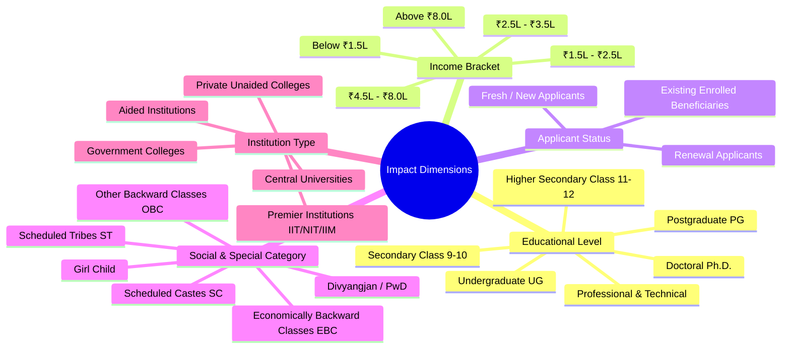

# Policy Intel: Multi-Dimensional Impact Analysis Methodology

## 1. Objective and Architecture

The **Impact Analysis Engine** translates raw, clause-level policy modifications into practical, cohort-specific consequences for students, educational institutions, and policy administrators.

In public policy, citizens and students do not read legal comparative diffs; they need to know:
- *Am I now eligible under the revised policy?*
- *Has my scholarship amount increased or decreased?*
- *Does this amendment affect my renewal or only new applicants?*
- *What specific procedural action must I take (e.g. Aadhaar linking, Freeship Card)?*

To ensure absolute legal safety, Policy Intel enforces a strict design principle:
> **Deterministic mathematical algorithms are used for all numeric thresholds, income bounds, dates, and percentages. LLMs are never permitted to independently fabricate or extrapolate affected groups or numbers.**

---

## 2. The Five Impact Dimensions

Every policy change is evaluated across five orthogonal dimensions:

---

## 3. Three-Tier Impact Categorization

The engine categorizes affected groups into three tiers based on legal directness:

### Tier 1: Explicitly Affected Groups (`EXPLICITLY_AFFECTED`)
- Demographic, academic, or social cohorts explicitly named in the statutory text of the clause.
- Example: *"For Group 1 degree and postgraduate professional courses, the maintenance allowance is ₹ 13,500 per annum for hostellers and ₹ 7,000 per annum for day scholars."*
- Cohorts identified:
  - Group 1 Degree and Postgraduate Professional Students
  - Hosteller SC Students
  - Day Scholar SC Students

### Tier 2: Deterministic Eligibility Deltas (`POTENTIALLY_AFFECTED`)
- Derived through rigorous mathematical interval calculation between predecessor and successor thresholds.

#### A. Income Ceiling Relaxation (Expansion of Eligibility)
When a new policy raises the income ceiling ($T_{\text{curr}} > T_{\text{prev}}$):
$$\text{Newly Eligible Interval} = (T_{\text{prev}}, T_{\text{curr}}] = \{ x \in \mathbb{R} \mid T_{\text{prev}} < x \le T_{\text{curr}} \}$$
- **Real Example (NMMSS Revision 2022)**:
  - Previous Income Ceiling: $T_{\text{prev}} = ₹ 1,50,000$ per annum
  - Current Income Ceiling: $T_{\text{curr}} = ₹ 3,50,000$ per annum
  - Deterministic Delta: Newly eligible cohort is students whose family income is in the interval:
    $$₹ 1,50,000 < \text{Annual Family Income} \le ₹ 3,50,000$$
  - Practical Consequence: Students previously rejected due to parental income between ₹1.5L and ₹3.5L can now apply.

#### B. Income Ceiling Restriction (Contraction of Eligibility)
When a policy tightens an income ceiling ($T_{\text{curr}} < T_{\text{prev}}$):
$$\text{Newly Excluded Interval} = (T_{\text{curr}}, T_{\text{prev}}] = \{ x \in \mathbb{R} \mid T_{\text{curr}} < x \le T_{\text{prev}} \}$$
- **Real Example (PM-USP CSSS Revision 2022)**:
  - Previous Ceiling: $T_{\text{prev}} = ₹ 6,00,000$ per annum
  - Current Ceiling: $T_{\text{curr}} = ₹ 4,50,000$ per annum
  - Deterministic Delta: Newly excluded cohort is fresh applicants whose family income is in the interval:
    $$₹ 4,50,000 < \text{Annual Family Income} \le ₹ 6,00,000$$

#### C. Renewal Criteria Shifts (Academic Stringency)
When renewal marks threshold shifts from $M_{\text{prev}}$ to $M_{\text{curr}}$:
- If $M_{\text{curr}} > M_{\text{prev}}$, the at-risk renewal cohort is:
  $$[M_{\text{prev}}, M_{\text{curr}}) = \{ m \in [0, 100] \mid M_{\text{prev}} \le m < M_{\text{curr}} \}$$

#### D. Scholarship Rate Revisions (Monetary Net Change)
$$\Delta \text{Benefit} = \text{Amount}_{\text{curr}} - \text{Amount}_{\text{prev}}$$
- **Real Example (PM-USP CSSS 2022)**:
  - Graduation Level: ₹10,000 $\rightarrow$ ₹12,000 (+₹2,000 / annum net increase).

### Tier 3: Unresolved / State-Discretionary Provisions (`UNRESOLVED`)
- Provisions that depend on unstated administrative parameters, state quota allocations, or discretionary guidelines.
- The engine marks these as `UNRESOLVED` rather than guessing, explicitly identifying the external documents or state government circulars required to resolve applicability.

---

## 4. Practical Consequences Generation

The engine parses procedural and administrative stipulations into unambiguous, actionable guidance:

| Policy Shift Keyword | Practical Consequence Output |
|---|---|
| `Aadhaar`, `DBT`, `APB` | **Mandatory Aadhaar Seeding**: Beneficiaries must ensure active bank accounts are seeded with Aadhaar on the NPCI mapper for Direct Benefit Transfer. |
| `Freeship Card` | **Freeship Card System**: Eligible SC students can generate a digital Freeship Card on the National Scholarship Portal to secure college admission without paying upfront tuition fees. |
| `DigiLocker` | **Digital Verification**: Caste and income certificates must be verified and fetched electronically through DigiLocker. |
| `Renewal first attempt` | **Strict Renewal Timelines**: Academic progression must be completed on first attempt; backlogs or compartmental promotions disqualify candidates. |

---

## 5. End-to-End Verification Case Studies

| Scheme | Document Baseline | Document Target | Verified Deterministic Impact | Verified Practical Consequence |
|---|---|---|---|---|
| **NMMSS** | 2017 Guidelines | 2022 Revision | Income ceiling expanded from ₹1.5L to ₹3.5L (Interval: ₹150,000 - ₹350,000). | Secondary students with income $\le ₹3.5L$ become eligible. |
| **PMS-SC** | 2018 Guidelines | 2020 Revision | Group 1 maintenance allowance revised to ₹13,500 (hostellers) & ₹7,000 (day scholars). | Freeship Card enables cashless institutional admission; DBT APB mandated. |
| **PM-USP CSSS** | 2015 Guidelines | 2022 Revision | Income ceiling standardized to ₹4.5L; UG scholarship rate increased by +₹2,000. | Mandatory Aadhaar-bank account seeding for Central DBT release. |
