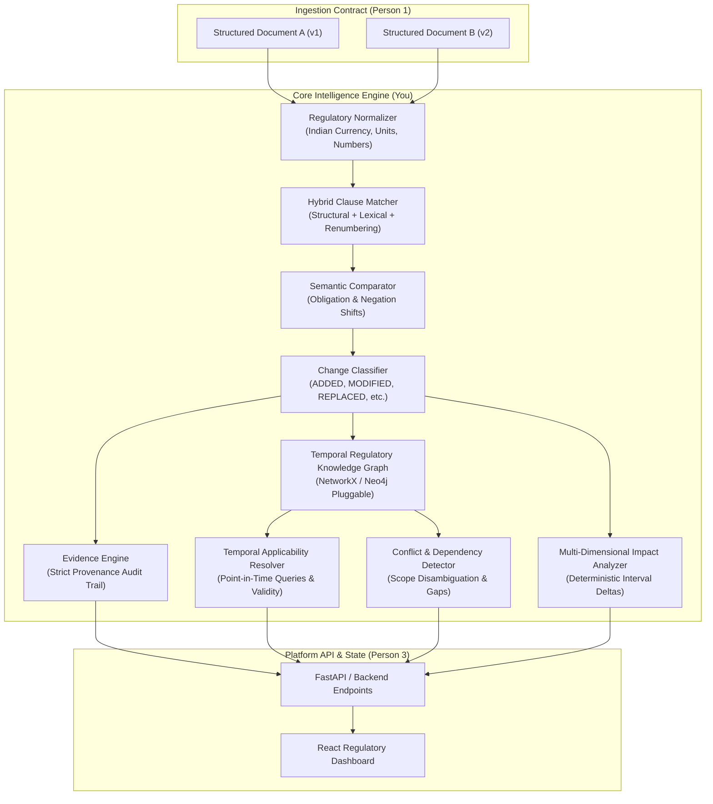

# Policy Intel: Regulatory Intelligence & Impact Analysis Architecture

## 1. System Overview

**Policy Intel** is a specialized regulatory intelligence engine engineered for Indian Central Government education policies and scholarship frameworks. Unlike generic LLM-based summary tools or standard Retrieval-Augmented Generation (RAG) pipelines, Policy Intel provides **time-aware, clause-level, deterministic, and evidence-backed regulatory reasoning**.

Government policies in India evolve through a dense sequence of notifications, office memorandums, gazette notifications, corrigenda, and multi-year scheme guideline revisions. Conventional RAG architectures struggle because:
- They lack point-in-time validity resolution (confusing historical rules with active ones).
- They rely on probabilistic semantic similarity, failing to perceive that small text changes (e.g. ₹2,00,000 to ₹2,50,000) have monumental legal consequences.
- They risk legal hallucination, claiming supersession without explicit statutory revoking orders.

Policy Intel solves this by decoupling regulatory understanding into specialized deterministic and semantic components, anchored by a **Temporal Regulatory Knowledge Graph** and an **Evidence Engine**.

---

## 2. Core Modules and Component Responsibilities

The intelligence package (`intelligence/`) is structured into specialized, decoupled components:

| Module | Primary Responsibility | Deterministic vs Probabilistic |
|---|---|---|
| [`config.py`](file:///intelligence/config.py) | Matcher thresholds, scoring weights, and backend configurations. | Deterministic config |
| [`normalizer.py`](file:///intelligence/normalizer.py) | Indian currency (₹, Lakh, Crore), percentage parsing, and clause formatting. | 100% Deterministic Regex & Rule-Based |
| [`semantic_comparator.py`](file:///intelligence/semantic_comparator.py) | Character n-gram cosine, token multiset overlap, modality, and negation shifts. | Deterministic mathematical algorithms + optional LLM hook |
| [`clause_matcher.py`](file:///intelligence/clause_matcher.py) | Global bipartite optimal alignment of clauses across policy versions; detects renumbering. | Deterministic Weighted Assignment |
| [`change_classifier.py`](file:///intelligence/change_classifier.py) | Classifies clause differences into 8 standard ChangeTypes; extracts structured value pairs. | Deterministic heuristics & regex |
| [`change_detector.py`](file:///intelligence/change_detector.py) | Top-level orchestrator comparing two documents; validates schema adherence. | Orchestration |
| [`knowledge_graph.py`](file:///intelligence/knowledge_graph.py) | Multi-relational temporal graph modeling schemes, documents, clauses, and amendments. | Deterministic Graph Structure (NetworkX) |
| [`temporal_resolver.py`](file:///intelligence/temporal_resolver.py) | Evaluates point-in-time validity, distinguishes publication vs effective vs validity dates. | Deterministic Date Logic |
| [`impact_analyzer.py`](file:///intelligence/impact_analyzer.py) | Computes cohort impacts, newly eligible income intervals, and practical consequences. | Deterministic Math for intervals; rule-grounded for cohorts |
| [`conflict_detector.py`](file:///intelligence/conflict_detector.py) | Disambiguates true legal contradictions from distinct beneficiary scopes (e.g. hosteller vs day scholar). | Deterministic Scope Matching |
| [`evidence_engine.py`](file:///intelligence/evidence_engine.py) | Strictly mandates and verifies that no claim or change record exists without verbatim citations. | Deterministic Provenance Enforcement |
| [`engine.py`](file:///intelligence/engine.py) | High-level facade integrating all intelligence capabilities for Person 3. | Unified Facade |

---

## 3. Data Flow and Execution Lifecycle

### Step 1: Ingestion & Normalization
- Person 1 provides structured `Document` instances containing metadata and extracted `Clause` items.
- `RegulatoryNormalizer` strips formatting anomalies, standardizes Indian rupee notations (`₹`, `Rs.`, `INR`, `Lakhs`, `Crores`), standardizes periodicity (`p.a.` to `per annum`), and cleans clause numbering.
- Numeric thresholds (e.g., annual family income ceilings, scholarship maintenance rates, minimum qualifying marks percentages, central-state cost-sharing ratios) are parsed into standardized scalar representations.

### Step 2: Clause Alignment & Change Detection
- `ClauseMatcher` computes an alignment matrix between previous and current clauses using a weighted hybrid score:
  $$\text{Score} = w_{\text{structural}} \cdot S_{\text{num}} + (w_{\text{lexical}} + w_{\text{semantic}}) \cdot S_{\text{lexical}}$$
- Renumbered clauses (e.g., Clause 4.2 becoming Clause 5.1 while retaining text) are detected when numbering similarity is low but textual similarity exceeds the renumbering threshold ($\ge 0.78$).
- Bipartite matching pairs clauses one-to-one, identifying:
  - Preserved / Identical clauses
  - Modified clauses
  - Added clauses (present in target, absent in base)
  - Removed clauses (present in base, absent in target)

### Step 3: Change Classification & Evidence Attachment
- `ChangeClassifier` categorizes matched pairs into `ADDED`, `REMOVED`, `MODIFIED`, `REPLACED`, `EXTENDED`, `EXEMPTED`, `CLARIFIED`, or `UNKNOWN`.
- Verbatim supporting text quotes are extracted and bound as `EvidenceRecord` objects.
- Quantitative parameter deltas (e.g., previous value = ₹150,000, current value = ₹350,000) are extracted.
- Crucial legal rule: Disappearance of a clause in a newer document is marked `REMOVED` with an explicit uncertainty stating that legal repeal requires statutory revoking orders.

### Step 4: Knowledge Graph Ingestion
- Documents, schemes, issuing ministries, clauses, conditions, and detected change events are populated into the `NetworkXRegulatoryGraph`.
- Temporal validity windows and evidence records are stamped onto both nodes and edges.

### Step 5: Temporal Point-in-Time Resolution
- Queries such as *"What were the eligibility rules on 1 August 2020?"* or *"What are the currently applicable conditions?"* are evaluated by `TemporalResolver`.
- Publication dates are strictly decoupled from effective dates (e.g., a notification published in December 2020 may have retroactive or forward enforcement).
- Pending amendments (published but not yet effective) and expired/superseded documents are partitioned.

### Step 6: Multi-Dimensional Impact Analysis
- `ImpactAnalyzer` analyzes detected changes across 5 dimensions:
  1. Educational level (UG, PG, Higher Secondary, Professional)
  2. Income level (deterministic newly eligible or excluded intervals)
  3. Applicant status (Fresh vs Renewal)
  4. Social and special categories (SC, ST, OBC, Divyang, Girls)
  5. Institution type (Government, Aided, Private Unaided, Premier)
- Practical consequences (e.g., Aadhaar DBT requirement, DigiLocker verification, Freeship Card availability) are generated.

### Step 7: Conflict & Dependency Auditing
- `ConflictDetector` identifies cross-document tensions.
- Disambiguates apparent contradictions that actually represent distinct operational scopes (e.g., ₹13,500 for hostellers vs ₹7,000 for day scholars; Group 1 professional courses vs Group 4 humanities).
- Flags missing predecessor documents and partial amendments.
