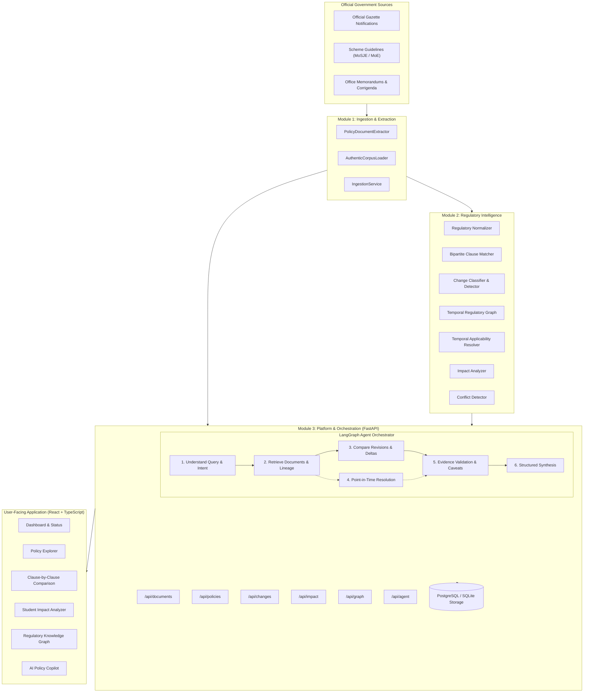

# Policy Intel: Full-Stack System Architecture & Agentic Workflow

## 1. Executive Summary & Purpose

**Policy Intel** is a full-stack regulatory intelligence platform specifically engineered to monitor, analyze, and communicate changes in Indian Central Government education policies and scholarship frameworks (e.g. Ministry of Social Justice and Empowerment, Ministry of Education).

Rather than acting as an ungrounded or probabilistic chatbot, Policy Intel unifies:
1. **Document Ingestion & Clause Extraction (Person 1 contract)**: Structural segmentation of official PDFs and gazettes into numbered, typed clauses with source links.
2. **Regulatory Intelligence & Reasoning Engine (Person 2 contract)**: Deterministic regex normalizers, bipartite clause matchers, semantic comparators, temporal validity resolvers, conflict detectors, and a multi-relational Knowledge Graph.
3. **Platform API, LangGraph Orchestration & Interactive UI (Our Ownership)**: FastAPI backend, relational database persistence (PostgreSQL/SQLite), stateful multi-step agentic investigation, and a professional React + TypeScript regulatory explorer.

---

## 2. End-to-End System Architecture

---

## 3. Data Contracts & Shared Schemas

All inter-module communication is governed strictly by Pydantic domain models in [`shared/schemas.py`](file:///shared/schemas.py):

| Contract Model | Consumer | Purpose |
|---|---|---|
| `Document` | Ingestion $\rightarrow$ Backend $\rightarrow$ Intelligence | Authoritative representation of an official policy, its metadata, source portal URL, and extracted clauses. |
| `Clause` | Ingestion $\rightarrow$ Intelligence $\rightarrow$ UI | Numbered section or clause, containing normalized text, clause type (`ELIGIBILITY`, `FINANCIAL`, `DEADLINE`, etc.), and structured legal attributes. |
| `ChangeRecord` | Intelligence $\rightarrow$ Backend $\rightarrow$ UI | Identifies modified clauses, classified into 8 canonical change types (`ADDED`, `MODIFIED`, `REPLACED`, `EXTENDED`, etc.), with previous vs current values and evidence. |
| `ImpactAnalysisReport` | Intelligence $\rightarrow$ Backend $\rightarrow$ UI | Categorizes affected student cohorts (`explicitly_affected`, `potentially_affected`, `unresolved`), deterministic deltas, and practical next steps. |
| `TemporalApplicabilityResult`| Intelligence $\rightarrow$ Backend $\rightarrow$ Agent | Point-in-time answer to: *"What were the active eligibility provisions on date X?"* |
| `AgentQueryResponse` | Agent $\rightarrow$ UI | Complete audit response containing direct answer, reasoning classification, step log, citations, confidence, and caveats. |

---

## 4. Multi-Step LangGraph Agentic Workflow

Instead of making simple one-shot LLM queries, our LangGraph agent executes a 10-step investigation state machine:

1. **Query Analysis & Intent Extraction**: Maps the user query to one of four investigative pathways: `CHANGE_INVESTIGATION`, `TEMPORAL_VALIDITY`, `CONFLICT_CHECK`, or `IMPACT_ANALYSIS`.
2. **Context Retrieval**: Pulls relevant policy lineages from both relational storage and the in-memory intelligence engine.
3. **Deterministic Tool Invocation**: Invokes the appropriate sub-engine (`compare_documents`, `analyze_impact`, `query_eligibility_at_date`, or `detect_conflicts`).
4. **Evidence Dossier Compilation**: Collects exact verbatim citations from official gazettes and policy guidelines.
5. **Confidence & Ambiguity Audit**: Computes aggregate verification confidence and flags missing statutory dates or transitional gaps.
6. **Structured Synthesis**: Outputs evidence-backed findings distinguishing **RETRIEVED FACTS**, **DETERMINISTIC CALCULATIONS**, **AI INFERENCES**, and **UNRESOLVED ISSUES**.

---

## 5. Persistence Strategy

- **Dual Engine Compatibility**: Seamlessly runs on SQLite for instantaneous local evaluation, or production PostgreSQL with connection pooling.
- **Traceability**: All stored changes and impact reports link foreign-key references back to official source document IDs and clause IDs.
- **Audit Logs**: Every query to `/api/agent/query` persists execution traces, tool outputs, and timestamps in `agent_audit_logs`.
